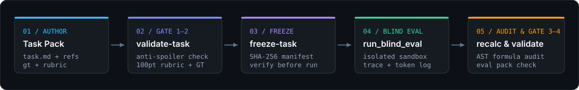

<p align="center">
  
</p>

<p align="center">
  <a href=".github/workflows/ci.yml"></a>
  <a href="https://www.python.org/"></a>
  <a href="#quick-start"></a>
  <a href="LICENSE"></a>
</p>

**agent-eval-pipeline** 是一套基于纯 Python 3.9+ 标准库的自动化评测管线，面向需要读写真实办公文件（`.xlsx` / `.docx` / `.pdf` / `.csv`）的 LLM Agent 任务。它解决三个核心工程问题：**离线验算 Excel 公式真伪**、**SHA-256 锁定评测基准防漂移**、以及**在仓库外隔离沙箱里做可审计的多模型盲测**。

---

## Architecture

<p align="center">
  
</p>

## Why This Exists

评测复杂财务、审计或教务核对类 Agent 任务时，直接读 `.xlsx` 单元格缓存值极易被“表面正确”的产物误导，而 CI / 沙箱容器里往往没有 Excel 或 LibreOffice。

举一个真实遇到的例子：某模型生成的财务复核工作簿包含 **796 条公式**，所有缓存数字肉眼核对几乎全对；用 `pack_gate.py recalc-xlsx` 做离线 AST 重算后，立刻暴露出其 `SUMIFS` 范围覆盖了自身衍生税费行，导致 **464 个单元格实际处于 `#CIRC!` 循环引用**：

```bash
$ python3 scripts/pack_gate.py recalc-xlsx model_output.xlsx
```

```json
{
  "file": "model_output.xlsx",
  "formula_total": 796,
  "error_count": 464,
  "cached_checked": 796,
  "cached_mismatch": 0,
  "errors": [
    {
      "sheet": "利润表重算",
      "coord": "D22",
      "formula": "=SUMIFS(调整分录!$F$2:$F$23, ...)",
      "error": "#CIRC!（检测到公式循环引用）"
    }
  ]
}
```

为此，本仓库用纯标准库实现了三个解耦组件：

- **离线 Excel AST 求值与门禁（[`scripts/pack_gate.py`](scripts/pack_gate.py)）**：直接解析 OOXML XML，支持 `_RangeArray` 数组广播、标量 `IF` 惰性求值、Excel 跨类型比较优先级（`number < text < bool`）及 25+ 常用财务/查找函数；同时提供 Gate 1–4 结构校验与 SHA-256 冻结。
- **隔离盲测编排器（[`scripts/run_blind_eval.py`](scripts/run_blind_eval.py)）**：开考前强制 `verify-freeze`，在仓库外按 `<task>/<run_id>/<model>` 构建隔离沙箱（仅投放 `task/task.md` 与 `reference_files/`），支持 `openai_compat` 与 `codex` 双通道并行运行；通过 `try...finally` 保证即便 1800s 超时（`rc=124`）也完整保留现场、轨迹与审计报告。
- **沙箱化工具执行器（[`scripts/openai_compat_agent.py`](scripts/openai_compat_agent.py)）**：标准 OpenAI Chat Completions Function Calling 循环，内置路径逃逸拦截（`_resolve_safe`），不依赖任何 SDK。

## Quick Start

无需 API Key，无需 `pip install`（仅需 Python 3.9+）：

```bash
# 1. 运行全部单元测试（公式数组广播 + 循环引用、缓存造假、冻结篡改、剧透拦截、路径逃逸）
python3 -m unittest discover -s tests -v

# 2. 运行零依赖端到端合成示例（生成示例任务包 -> Gate 1/2 -> 42 条公式重算 -> SHA-256 冻结与核验）
python3 examples/build_toy_demo.py
```

## CLI Reference

| 命令 | 用途 |
| --- | --- |
| `python3 scripts/pack_gate.py validate-task <task_dir>` | Gate 1 & 2 验收（防剧透、多格式材料、100 分 Rubric、GT 0 报错） |
| `python3 scripts/pack_gate.py freeze-task <task_dir> --out <freeze.json>` | 对题面与参考材料生成 SHA-256 冻结指纹 |
| `python3 scripts/pack_gate.py verify-freeze <task_dir> --freeze <freeze.json>` | 逐字节核验任务包未发生篡改 |
| `python3 scripts/pack_gate.py recalc-xlsx <file.xlsx> [--json-out <out.json>]` | 离线 AST 重算任意 `.xlsx` 公式并校验缓存一致性 |
| `python3 scripts/run_blind_eval.py --task-pack ... --freeze ... --runs-dir ... --models-config models.json` | 校验冻结后启动多模型隔离盲测并自动审计落盘 |
| `python3 scripts/pack_gate.py validate-eval <eval_dir> --rubric <rubric.xlsx>` | Gate 3 & 4 验收评测包与交付记录 |

<details>
<summary>展开查看多模型盲测配置与产物目录说明</summary>

### 1. 配置环境与模型矩阵

```bash
cp .env.example .env
cp models.example.json models.json
```

在 `.env` 中填入 `OPENAI_BASE_URL` / `OPENAI_API_KEY`，在 `models.json` 中配置待测模型列表。

### 2. 单模型落盘结构

```text
<runs-dir>/<run_id>/<label>/
├── input_manifest.json   # 输入文件 SHA-256 核对记录
├── prompt_used.txt       # 实际下发的中性提示词快照
├── 运行事件.jsonl         # 完整多轮交互与工具调用轨迹
├── 最终回复.md            # 模型最终总结回复
├── workspace/output/     # 模型产出的全部交付文件
├── audit_summary.json    # 越界/联网关键词扫描 + .xlsx AST 重算审计
└── meta.json             # 起止时间、耗时、退出码与 token 统计
```

</details>

## Repository Layout

```text
.
├── .github/workflows/ci.yml       # Python 3.9 / 3.11 / 3.12 自动 CI
├── assets/                        # Banner 与架构矢量图
├── docs/methodology.md            # 任务构建、四道门禁与公平盲测方法论
├── scripts/
│   ├── pack_gate.py               # Gate 1–4 验收、SHA-256 冻结与离线 Excel AST 重算
│   ├── openai_compat_agent.py     # OpenAI 兼容多轮 Function Calling 隔离 Agent
│   └── run_blind_eval.py          # 统一公平盲测编排器
├── examples/
│   └── build_toy_demo.py          # 零依赖合成示例
├── tests/
│   ├── test_pack_gate_recalc.py   # 公式与数组运算单测
│   └── test_security_and_gates.py # 循环引用、缓存造假、冻结篡改与路径逃逸负向测试
├── .env.example
├── models.example.json
└── LICENSE
```

## Anti-Contamination

本仓库仅包含通用评测框架与合成示例，不包含任何真实业务题库、`ground_truth` 或真实模型盲测日志。建议将生产题库存放在独立私有仓库中管理，避免基准泄露。

---

Released under the [MIT License](LICENSE).
