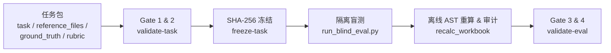

# agent-eval-pipeline

[](.github/workflows/ci.yml)
[](https://www.python.org/)
[](LICENSE)

一套用于复杂办公与专业文件任务（Excel / Word / PDF）的模型盲测与自动化验收工具，全部基于 Python 3.9+ 标准库实现，无第三方依赖。

主要用来解决在无 Excel / LibreOffice 的环境下，对大模型产出的 `.xlsx` 底稿做离线公式重算、对任务包做防篡改冻结，以及在隔离目录里统一跑多模型盲测。

## 流程



核心由三部分组成：

- `scripts/pack_gate.py`：任务包与评测包校验（Gate 1–4）、SHA-256 冻结与核验，以及一个纯 Python 实现的 OOXML `.xlsx` 离线公式 AST 求值器。
- `scripts/run_blind_eval.py`：盲测前强制校验冻结指纹，在仓库外按 `<task>/<run_id>/<model>` 建隔离目录，仅投放 `task/task.md` 与 `reference_files/`，跑完（包括超时）后统一归档产物、轨迹、token 用量与公式审计结果。
- `scripts/openai_compat_agent.py`：通用的 OpenAI 兼容 Chat Completions 多轮工具调用封装（`list_dir` / `read_file` / `write_file` / `bash`），内置路径逃逸限制。

## 为什么自己写离线 Excel 重算器

评测复杂财务或核对任务时，只读 `.xlsx` 的缓存值经常会漏掉严重问题，而在 CI 或隔离沙箱里通常不方便装 Excel 或 LibreOffice：

1. **隐蔽的循环引用**：实际测过一份模型生成的 796 条公式的财务底稿，所有单元格缓存数字看起来都对，但用 AST 离线重算发现其 `SUMIFS` 范围覆盖了衍生税费行，导致 464 个单元格实际处于 `#CIRC!` 循环引用。
2. **数组公式与跨类型比较**：`SUMPRODUCT(--(ISNUMBER(rng))*(rng<>0))`、`IF` 数组广播以及 Excel 的类型比较优先级（`数值 < 文本 < 布尔`）在普通解析器里容易误报 `#VALUE!`，因此单独补齐了 `_RangeArray` 广播语义与回归单测。
3. **长链路超时留证**：部分模型跑满 1800s 超时（`rc=124`）时只来得及生成部分交付物；运行器通过 `finally` 兜底保留现场文件和全部事件日志，验收器允许配合 `缺失交付物说明.txt` 如实入账，不做人工补全。

当前重算器支持常见函数与语法：`SUM`、`SUMIF`、`SUMIFS`、`SUMPRODUCT`、`COUNTIF`、`COUNTIFS`、`AVERAGE`、`ROUND`、`ROUNDUP`、`ROUNDDOWN`、`IF`（含标量惰性求值与数组分支）、`IFERROR`、`IFNA`、`VLOOKUP`、`INDEX`、`MATCH`、`MOD`、`SIGN`、`LEFT`、`RIGHT`、`MID`、`CONCAT`、`ISNUMBER`、`ISTEXT`、`ISERROR`。

## 本地验证

需要 Python 3.9+，无需安装依赖：

```bash
# 运行单元测试（公式/数组重算 + 循环引用、缓存不一致、冻结篡改、剧透拦截、路径逃逸）
python3 -m unittest discover -s tests -v

# 运行合成示例（生成示例任务包 -> Gate 1/2 -> 42 条公式重算 -> 冻结与核验）
python3 examples/build_toy_demo.py
```

## 使用方式

### 1. 准备配置

```bash
cp .env.example .env
cp models.example.json models.json
```

在 `.env` 中填入 `OPENAI_BASE_URL` / `OPENAI_API_KEY`，在 `models.json` 中配置待测模型（支持 `openai_compat` 和 `codex` 两种运行通道）。

### 2. 校验与冻结任务包

```bash
# Gate 1 & 2 校验
python3 scripts/pack_gate.py validate-task /path/to/task_pack

# 生成冻结指纹
python3 scripts/pack_gate.py freeze-task /path/to/task_pack --out /path/to/freeze.json

# 校验冻结完整性
python3 scripts/pack_gate.py verify-freeze /path/to/task_pack --freeze /path/to/freeze.json

# 单独重算任意 .xlsx
python3 scripts/pack_gate.py recalc-xlsx /path/to/workbook.xlsx
```

### 3. 运行隔离盲测

```bash
python3 scripts/run_blind_eval.py \
  --task-pack /path/to/task_pack \
  --freeze /path/to/freeze.json \
  --runs-dir /path/to/blind_runs \
  --models-config models.json \
  --run-id run_01 \
  --timeout 1800
```

每个模型会在 `<runs-dir>/<run_id>/<label>/` 下落盘：

```text
input_manifest.json   # 输入文件 SHA-256 核对记录
prompt_used.txt       # 实际下发的中性提示词
运行事件.jsonl         # 完整多轮交互与工具调用记录
最终回复.md            # 模型最终回复
workspace/output/     # 模型产出的交付文件
audit_summary.json    # 越界/联网关键词扫描 + .xlsx AST 重算结果
meta.json             # 耗时、退出码与 token 统计
```

### 4. 验收评测包（Gate 3 & 4）

```bash
python3 scripts/pack_gate.py validate-eval /path/to/eval_pack \
  --rubric /path/to/task_pack/rubric/rubric.xlsx
```

## 目录结构

```text
.
├── .github/workflows/ci.yml       # Python 3.9 / 3.11 / 3.12 CI
├── docs/methodology.md            # 出题、四道门禁与盲测规范说明
├── scripts/
│   ├── pack_gate.py               # 门禁校验、SHA-256 冻结与离线 Excel AST 重算
│   ├── openai_compat_agent.py     # OpenAI 兼容多轮工具调用封装
│   └── run_blind_eval.py          # 隔离盲测运行器
├── examples/
│   └── build_toy_demo.py          # 合成数据端到端示例
├── tests/
│   ├── test_pack_gate_recalc.py   # 公式与数组重算测试
│   └── test_security_and_gates.py # 门禁与安全边界负向测试
├── .env.example
├── models.example.json
└── LICENSE
```

## 说明

本仓库只包含评测框架代码和一个合成示例，不包含任何真实业务题库、标准答案或具体模型的原始盲测数据。实际评测题库建议放在私有仓库中管理，避免基准泄露。

MIT License，见 [LICENSE](LICENSE)。
