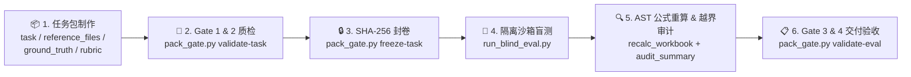

<div align="center">

# 🧪 Agent Eval Pipeline

**面向复杂办公与专业领域任务（Excel / Word / PDF）的自动化质检门禁、SHA-256 防篡改冻结与公平隔离盲测框架**

[](https://www.python.org/)
[-2ea44f)](#核心能力)
[](LICENSE)
[](.github/workflows/ci.yml)

[快速开始](#-30-秒快速体验零依赖) · [架构总览](#-架构总览) · [实战抓坑案例](#-实战抓坑记录已脱敏) · [多模型盲测](#-运行真实多模型公平盲测) · [方法论](docs/methodology.md)

</div>

---

## 🎯 它解决什么问题？

评测大模型 Agent 处理真实专业工作（财务期末结账调账、审计底稿复核、教务学分核查、运营报表分析）时，简单的“问答打分”完全不够用。这套纯 Python 零依赖管线把**出题 → 质检 → 封卷 → 隔离闭卷盲测 → 离线验算 → 评测交付**做成了一条可复现的工程流水线：

| 常见评测痛点 | 本管线的工程解法 |
| --- | --- |
| **Excel 公式“金玉其外”**：单元格缓存数字看着对，点开全是 `#CIRC!` 循环引用或 `#VALUE!`，且服务器无 Excel / LibreOffice | 内置**零依赖离线 Excel 公式 AST 重算器**，直接解析 `.xlsx` 底层 XML，检测报错、循环引用与缓存不一致 |
| **试卷本身有错或剧透**：材料里不小心带上答案线索、Rubric 合计不是 100 分、标准答案公式出错 | **Gate 1 & Gate 2 自动门禁**，拦截剧透文件名/辅助列、校验 Rubric 权重与 GT 全表 0 报错 |
| **版本漂移**：测完模型 A 又微调了材料，模型 B 考的其实不是同一张卷子 | **SHA-256 冻结指纹**，盲测启动前强校验 `verify-freeze`，改动 1 个字节即拒绝运行 |
| **作弊与偏心**：模型在原仓库里可能读到 `ground_truth/`、`rubric/` 或联网搜索 | **仓库外独立隔离沙箱** + 路径逃逸拦截 + 统一中性提示词 + 事后事件流越界扫描 |
| **超时丢现场**：长链路任务跑到 30 分钟超时，日志和半成品全丢 | `try...finally` 强制归档现场产物、逐轮轨迹、token/耗时，如实记录部分交付，严禁造假 |

---

## 🏗 架构总览



---

## 💡 实战抓坑记录（已脱敏）

这套管线并非纸上谈兵，以下均为在真实多模型复杂表格任务评测中**自动抓出的高价值问题**：

- **抓出 464 个隐蔽循环引用（`#CIRC!`）**：某旗舰对照模型生成的财务复核 `.xlsx` 包含 796 条动态公式，肉眼查看所有缓存结果几乎全对；但离线 AST 重算器立即检出其 `SUMIFS` 区域覆盖了自身衍生税费行，导致 **464 个单元格实际处于 `#CIRC!` 循环引用状态**（而另一模型主动截断求和区间，765 条公式 0 报错）。
- **区分真错误与数组公式误报**：早期常规解析器会把 `SUMPRODUCT(--(ISNUMBER(rng))*(rng<>0))` 等合法数组公式误判为 `#VALUE!`；升级支持 `_RangeArray` 逐元素广播与 Excel 跨类型比较优先级（`数值 < 文本 < 布尔`）后，误报归零，精准锁定真实公式缺陷。
- **长链路超时（1800s）完整留证**：某模型在 77 轮交互、消耗近 600 万 input tokens 后触发 1800s 超时（`rc=124`），仅产出 `.xlsx` 未产出 `.docx`。`finally` 兜底机制完整保存了全部轨迹与半成品，并配合 `缺失交付物说明.txt` 通过 Gate 3 验收，既不丢数据也不人工补造结果。

---

## ✨ 核心能力

- **纯 Python 3.9+ 标准库实现，零第三方依赖**：开箱即用，无 `openpyxl` / `LibreOffice` / `Excel` 环境依赖。
- **离线 Excel AST 公式求值引擎（`scripts/pack_gate.py`）**：
  - 支持 `SUM` / `SUMIF` / `SUMIFS` / `SUMPRODUCT` / `COUNTIF` / `COUNTIFS` / `AVERAGE` / `ROUND` / `ROUNDUP` / `ROUNDDOWN` / `IF`（标量惰性求值 + 数组广播）/ `IFERROR` / `IFNA` / `VLOOKUP` / `INDEX` / `MATCH` / `MOD` / `SIGN` / `LEFT` / `RIGHT` / `MID` / `CONCAT` / `ISNUMBER` / `ISTEXT` / `ISERROR`。
  - 输出精确到单元格的 `formula_total`、`error_count`（含 `#CIRC!`）、`cached_checked` 与 `cached_mismatch`。
- **双通道公平盲测运行器（`scripts/run_blind_eval.py`）**：
  - 支持 **OpenAI 兼容 Chat Completions（Function Calling）** 与 **Codex CLI** 双通道，通过 `models.json` 灵活配置模型矩阵。
  - 按 `<task_pack>/<run_id>/<model_label>` 自动隔离目录，并行或串行运行，统一落盘 `meta.json`、`audit_summary.json`、`input_manifest.json`、`运行事件.jsonl` 与 `workspace/`。

---

## ⚡ 30 秒快速体验（零依赖）

无需任何 API Key，无需 `pip install`，只要本机有 Python 3.9+：

```bash
# 1. 运行全量单元测试（公式数组重算 + 循环引用/缓存造假/冻结篡改/剧透拦截/路径逃逸）
python3 -m unittest discover -s tests -v

# 2. 运行端到端合成示例（生成 Toy 任务包 -> Gate 1/2 -> 42 条公式 AST 重算 -> SHA-256 冻结与核验）
python3 examples/build_toy_demo.py
```

示例输出：

```text
✅ Gate 1 & 2 验收通过：.../demo_output/任务包_DEMO_星辰商贸订单对账
✅ 离线 AST 重算完成：formulas=42, errors=0, cached_mismatch=0
✅ 已冻结任务包指纹（10 个文件）：.../demo_output/冻结指纹.json
✅ 冻结指纹校验通过（10 个文件逐字节一致）
🎉 全链路合成示例运行成功！
```

---

## 🚀 运行真实多模型公平盲测

### 1. 配置密钥与模型矩阵

```bash
cp .env.example .env
cp models.example.json models.json
# 编辑 .env 填入 OPENAI_BASE_URL / OPENAI_API_KEY
# 编辑 models.json 配置待测模型列表
```

### 2. 验收并冻结任务包

```bash
# Gate 1 & 2 自动验收
python3 scripts/pack_gate.py validate-task /path/to/your_task_pack

# 生成 SHA-256 冻结指纹
python3 scripts/pack_gate.py freeze-task /path/to/your_task_pack --out /path/to/freeze.json

# 核验冻结完整性
python3 scripts/pack_gate.py verify-freeze /path/to/your_task_pack --freeze /path/to/freeze.json

# 单独对任意 .xlsx 执行离线 AST 公式审计
python3 scripts/pack_gate.py recalc-xlsx /path/to/workbook.xlsx
```

### 3. 启动隔离盲测

```bash
python3 scripts/run_blind_eval.py \
  --task-pack /path/to/your_task_pack \
  --freeze /path/to/freeze.json \
  --runs-dir /path/to/blind_runs \
  --models-config models.json \
  --run-id run_01 \
  --timeout 1800
```

每个模型运行完成后都会在 `<runs-dir>/<run_id>/<label>/` 自动归档：

```text
<runs-dir>/<run_id>/<label>/
├── input_manifest.json   # 投放文件逐一核对 SHA-256 记录
├── prompt_used.txt       # 实际下发的中性提示词快照
├── 运行事件.jsonl         # 完整多轮交互与工具调用轨迹
├── 最终回复.md            # 模型最终总结回复
├── workspace/output/     # 模型产出的全部交付文件
├── audit_summary.json    # 越界关键词扫描 + Excel AST 公式重算审计
└── meta.json             # 起止时间、耗时、退出码、token 用量
```

### 4. 验收体验评测包（Gate 3 & 4）

```bash
python3 scripts/pack_gate.py validate-eval /path/to/your_eval_pack \
  --rubric /path/to/your_task_pack/rubric/rubric.xlsx
```

---

## 📂 目录结构

```text
.
├── .github/workflows/ci.yml       # Python 3.9 / 3.11 / 3.12 自动 CI
├── docs/methodology.md            # 任务构建、四道门禁与公平盲测方法论
├── scripts/
│   ├── pack_gate.py               # Gate 1–4 验收器 + 离线 Excel AST 重算 + SHA-256 冻结
│   ├── openai_compat_agent.py     # 通用 OpenAI 兼容 Function Calling 隔离 Agent
│   └── run_blind_eval.py          # 统一公平盲测编排器
├── examples/
│   └── build_toy_demo.py          # 零依赖端到端合成示例
├── tests/
│   ├── test_pack_gate_recalc.py   # 公式与数组运算单元测试
│   └── test_security_and_gates.py # 循环引用、缓存造假、冻结篡改与沙箱越界负向测试
├── .env.example
├── models.example.json
└── LICENSE
```

---

## 🛡 数据防污染声明

本仓库**仅包含通用评测框架代码与 100% 合成玩具示例**，不包含任何真实业务评测题库、`ground_truth` 标准答案或真实模型盲测日志。建议将生产题库保存在独立的私有仓库中，防止被爬虫收录导致基准污染。

---

## 📄 License

本项目基于 [MIT License](LICENSE) 开源。
