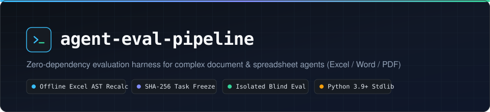

<p align="center">
  
</p>

**agent-eval-pipeline** 用于评测处理办公文件的 Agent。你可以复查一道题如何定稿、模型实际收到哪些文件，以及每一分的依据。

## 从一道 Excel 题开始

费用表的三笔明细加起来是 600 元，合计格的缓存也显示 600。离线重算却在 `Expenses!B5` 发现 `=SUM(B2:B5)` 引用了自身。只提交正确金额得 **40/100**，同时定位自引用得 **100/100**。

[查看题面](examples/circular_audit/pack/task/task.md) · [查看模拟审稿与评分依据](examples/circular_audit/) · [查看参考答案](examples/circular_audit/pack/ground_truth/answer.json)

## Quick Start

在 Python 3.9+ 环境中运行，无需模型密钥。示例使用合成数据，目前待专家复核。

```bash
python3 -m pip install -r requirements.txt
python3 examples/circular_audit/run.py
```

脚本会核对冻结文件、按盲测规则投放题面与工作簿，然后输出两份提交的逐项评分。运行完整测试和多文件对账示例：

```bash
python3 -m unittest discover -s tests -v
python3 examples/build_toy_demo.py
```

## Architecture


## CLI Reference

| 命令 | 用途 |
| --- | --- |
| `python3 scripts/pack_gate.py validate-task <task_dir>` | Gate 1 & 2 验收（防剧透、多格式材料、100 分 Rubric、GT 0 报错） |
| `python3 scripts/pack_gate.py freeze-task <task_dir> --out <freeze.json>` | 对题面与参考材料生成 SHA-256 冻结指纹 |
| `python3 scripts/pack_gate.py verify-freeze <task_dir> --freeze <freeze.json>` | 逐字节核验任务包未发生篡改 |
| `python3 scripts/pack_gate.py recalc-xlsx <file.xlsx> [--json-out <out.json>]` | 离线 AST 重算任意 `.xlsx` 公式并校验缓存一致性 |
| `python3 scripts/run_blind_eval.py --task-pack ... --freeze ... --runs-dir ... --models-config models.json` | 校验冻结后启动多模型隔离盲测并自动审计落盘 |
| `python3 scripts/pack_gate.py validate-eval <eval_dir> --rubric <rubric.xlsx>` | Gate 3 & 4 验收评测包与交付记录 |

<details>
<summary>展开查看多模型盲测配置与产物目录说明</summary>

### 1. 配置环境与模型矩阵

```bash
export OPENAI_API_KEY="你的密钥"
cp models.example.json models.json
```

在 `models.json` 中配置待测模型列表。

### 2. 单模型落盘结构

```text
<runs-dir>/<run_id>/<label>/
├── input_manifest.json   # 输入文件 SHA-256 核对记录
├── prompt_used.txt       # 实际下发的中性提示词快照
├── 运行事件.jsonl         # 完整多轮交互与工具调用轨迹
├── 最终回复.md            # 模型最终总结回复
├── workspace/output/     # 模型产出的全部交付文件
├── audit_summary.json    # 越界/联网关键词扫描 + .xlsx AST 重算审计
└── meta.json             # 起止时间、耗时、退出码与 token 统计
```

</details>

## Repository Layout

```text
.
├── assets/                        # Banner 与架构矢量图
├── docs/methodology.md            # 任务构建、四道门禁与公平盲测方法论
├── scripts/
│   ├── pack_gate.py               # Gate 1–4 验收、SHA-256 冻结与离线 Excel AST 重算
│   ├── openai_compat_agent.py     # OpenAI 兼容多轮 Function Calling 隔离 Agent
│   └── run_blind_eval.py          # 统一公平盲测编排器
├── examples/
│   ├── circular_audit/            # 审题、冻结输入与逐项判分
│   └── build_toy_demo.py          # 多文件对账示例
├── tests/
│   ├── test_pack_gate_recalc.py   # 公式与数组运算单测
│   └── test_security_and_gates.py # 循环引用、缓存造假、冻结篡改与路径逃逸负向测试
├── models.example.json
└── LICENSE
```

## Anti-Contamination

本仓库仅包含通用评测框架与合成示例，不包含任何真实业务题库、`ground_truth` 或真实模型盲测日志。建议将生产题库存放在独立私有仓库中管理，避免基准泄露。

---

Released under the [MIT License](LICENSE).
